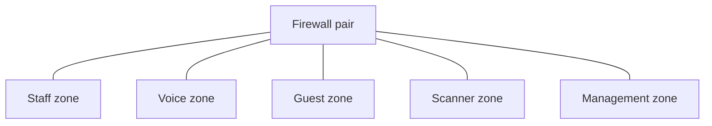

# Security and resilience design

## Segmentation
Traffic is split by function, and the firewall controls what crosses between zones.

| Zone | Allowed to reach | Blocked from |
|------|------------------|--------------|
| Staff | Internet, internal servers | Management |
| Voice | Phone system only | Everything else |
| Guest | Internet only | All internal networks |
| Scanners | Warehouse app only | Internet, staff |
| Management | Network devices | Everything else, admin access only |

## Hardening basics
- Management access over SSH only, no telnet
- Admin logins through central authentication (RADIUS or TACACS+)
- Unused switch ports shut down and placed in a dead VLAN
- Port security on access ports
- Device logs sent to a central log server

## Failure scenarios
| If this fails | What happens |
|---------------|--------------|
| One core switch | Second core carries all traffic |
| One uplink | Traffic uses the other uplink |
| One firewall | Second firewall takes over |
| Access switch | Only the devices on that switch are affected |
