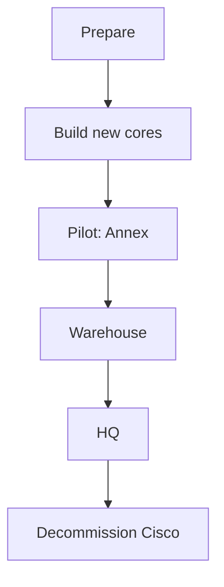

# Migration plan: Cisco to Juniper

Approach: build the new core alongside the old network, then move one building at a time, smallest and lowest risk first.

## Phases
| Phase | What happens | Rollback |
|-------|--------------|----------|
| Prepare | Inventory devices, convert configs, test in a lab | Nothing live is touched |
| Build new cores | Install and configure Juniper cores in parallel with the old network | Leave unused until ready |
| Pilot: Annex | Move the smallest building first and watch for a week | Re-patch uplinks back to Cisco |
| Warehouse | Cut over outside shift hours, test scanners before staff arrive | Re-patch to Cisco |
| HQ | Cut over floor by floor over several weekends | Re-patch per floor |
| Decommission | Keep the old Cisco gear powered off for 30 days, then remove | Power back on |

## Risks
| Risk | Mitigation |
|------|------------|
| Config differences between vendors cause surprises | Test converted configs in a lab first |
| Scanners lose connectivity during cutover | Test in a maintenance window, keep a rollback ready |
| Long outage if something fails | Change window agreed in advance, rollback tested |

## Lessons from real migrations
(Add your own here.)
