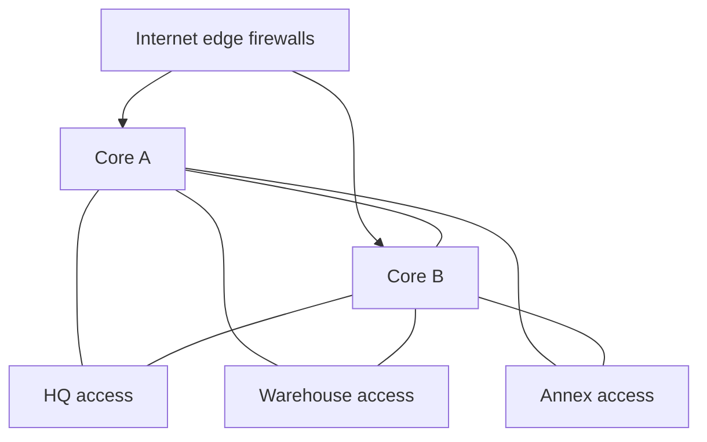

# High-level design

## Topology
Collapsed core with dual-homed access layers.

- Two Juniper core switches at HQ handle routing for all buildings
- Each building's access layer uplinks to both cores
- A firewall pair at the edge handles internet and segmentation

## Why this design
- 500 users across 3 buildings doesn't justify a separate distribution layer
- Dual uplinks meet the redundancy requirement
- Trade-off: the core pair is a larger failure domain, reduced by running two cores
